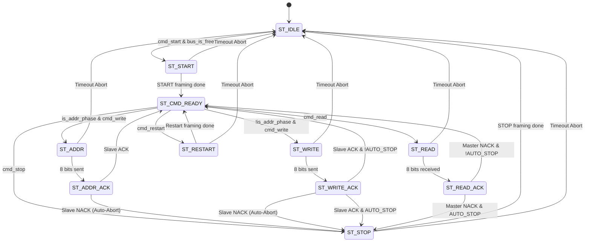

# System Architecture & Technical Specification

**Project:** Design and Verification of an AHB-Lite Based I²C Master Controller with Programmable Clock Generation and Hardware Clock-Stretching Timeout  
**Author:** Darshan Bhanderi  
**Design Standard:** IEEE 1800-2012 SystemVerilog (Synthesizable RTL)  

---

## 1. Top-Level Architectural Overview

The top-level module `i2c_master_top` integrates three structural sub-blocks:
1. `ahb_lite_slave_if u_ahb_slave`: The bus protocol adapter.
2. `i2c_registers u_registers`: The memory-mapped register bank and interrupt manager.
3. `i2c_master u_master`: The protocol controller FSM, containing `i2c_clock_gen` and `i2c_timeout`.

```
========================================================================================================
                                           i2c_master_top
========================================================================================================

    AHB-Lite 32-bit Host Bus
    -----------------------------------------------+
    HCLK, HRESETn, HADDR, HWDATA,                   |
    HWRITE, HSEL, HTRANS, HREADY                    |
                                                    v
                                    +------------------------------+
                                    |      ahb_lite_slave_if       |
                                    |                              |
                                    | - Address Phase Pipeline     |
                                    | - Zero Wait-State Control    |
                                    | - Read/Write Strobe Gen      |
                                    +------------------------------+
                                             |            ^
                                reg_write_en |            | HRDATA
                                 reg_read_en |            | HREADYOUT = 1
                                    reg_addr |            | HRESP = OKAY
                                   reg_wdata |            | reg_rdata
                                             v            |
                                    +------------------------------+
                                    |        i2c_registers         |
                                    |                              |
                                    | - 8 Memory-Mapped Registers  |
                                    | - W1C Interrupt Controller   |
                                    | - Status Flags & RX Clear    |
                                    +------------------------------+
                                             |            ^
                            Control, Command |            | Hardware Status,
                            Clock Dividers,  |            | RX Data, Valid,
                            Timeout Limit,   |            | Error Pulses,
                            TX Data Byte     |            | Done Pulses
                                             v            |
                                    +------------------------------+
                                    |          i2c_master          |
                                    |                              |
                                    | +--------------------------+ |
                                    | |     12-State FSM Core    | |
                                    | +--------------------------+ |
                                    | |   i2c_clock_gen (SCL)    | |
                                    | +--------------------------+ |
                                    | |   i2c_timeout (Watchdog) | |
                                    | +--------------------------+ |
                                    +------------------------------+
                                             |            ^
                               scl_drive_low |            | scl_sync (2-flop)
                               sda_drive_low |            | sda_sync (2-flop)
                                             v            |
                                    +------------------------------+
                                    |   Bi-directional Tri-State   |
                                    |   I/O Pads & Synchronizers   |
                                    +------------------------------+
                                                   ||
                                             scl_io  sda_io
                                             (Open-Drain Bus)
========================================================================================================
```

---

## 2. Sub-Module Deep-Dive

### 2.1 AHB-Lite Slave Adapter (`ahb_lite_slave_if.sv`)
- **Pipelined Transfer Capture:** 
  AHB-Lite transfers consist of an Address Phase and a Data Phase. 
  When `HSEL && HREADY && (HTRANS == 2'b10 || HTRANS == 2'b11)`, the adapter samples `HADDR`, `HWRITE`, and sets `valid_data_phase_q <= 1'b1` on `posedge HCLK`.
- **Zero Wait-State Operation:** 
  During the Data Phase, `reg_write_en` or `reg_read_en` is asserted for exactly 1 HCLK cycle. `HREADYOUT` is tied constantly to `1'b1`.
- **Address Word Alignment:** 
  Internal registers are 32-bit aligned: `reg_addr = {HADDR[7:2], 2'b00}`.
- **Unmapped Address Isolation:** 
  Accesses to unmapped address offsets inside the peripheral boundary safely return `32'h00000000` on reads with `HRESP = 1'b0 (OKAY)`, ensuring no CPU bus fault traps or internal state corruption.

---

### 2.2 Memory-Mapped Register Bank (`i2c_registers.sv`)
The register bank manages hardware/software concurrency:
- **Command Strobes:** Writing a non-zero value to `ADDR_COMMAND` (0x14) generates 1-cycle command pulses (`cmd_start_o`, `cmd_write_o`, `cmd_read_o`, `cmd_stop_o`, `cmd_restart_o`) and automatically clears sticky status flags (`DONE`, `ACK_ERROR`, `TIMEOUT_ERROR`).
- **Read-on-Clear for RX_DATA:** Reading `ADDR_RX_DATA` (0x10) automatically clears `STATUS.RX_VALID` on the same cycle, ensuring clean double-buffering.
- **Write-1-to-Clear (W1C) Interrupt Pending Flags:**
  Bits `[2:0]` of `ADDR_IRQ` latch hardware event pulses (`DONE`, `ACK_ERROR`, `TIMEOUT`). Writing a `1` to the respective bit clears the pending flag.
  **Hardware Precedence:** If a hardware error occurs on the exact clock cycle software attempts a W1C write, the hardware update takes absolute precedence to prevent dropped events.

---

### 2.3 Programmable Clock Generator (`i2c_clock_gen.sv`)
The clock generator produces the serial clock (SCL) half-phases from 100 MHz `HCLK`:
- **State Machine:**
  - `STATE_IDLE`: SCL is held in its inactive state.
  - `STATE_SCL_LOW`: Drives `scl_drive_low = 1` for `LOW_COUNT` cycles.
  - `STATE_WAIT_SCL_HIGH`: Releases `scl_drive_low = 0`. If physical `scl_sync` is `0` (clock stretching), the state machine pauses.
  - `STATE_SCL_HIGH`: Physical SCL has risen; counts `HIGH_COUNT` cycles before terminating the bit cycle with a 1-cycle `cycle_done` pulse.
- **Synchronous Abort:**
  An active `abort_i` signal immediately terminates active counting, deasserts `busy` and `stretch_wait`, suppresses any pending `cycle_done`, releases `scl_drive_low`, and resets the module to `STATE_IDLE`.

---

### 2.4 Hardware Timeout Engine (`i2c_timeout.sv`)
- **Qualification Criteria:**
  The counter increments on `posedge HCLK` if and only if:
  1. `timeout_limit_i != 32'd0` (Feature enabled).
  2. `scl_released_i == 1'b1` (Master has released SCL).
  3. `scl_in_i == 1'b0` (Physical SCL is still held LOW by an external slave).
- **Exact-N Single Pulse:**
  When `count_q == timeout_limit_i`, `timeout_event` pulses HIGH for exactly 1 HCLK cycle, and `timeout_fired_q` latches HIGH to prevent re-triggering during the same continuous stretching episode.
- **Auto-Clear:**
  Whenever physical SCL rises HIGH or the master pulls SCL LOW, `count_q` and `timeout_fired_q` are reset immediately to `0`.

---

### 2.5 I²C Protocol FSM (`i2c_master.sv`)
The core controller implements a deterministic 12-state Mealy/Moore hybrid FSM:



#### Priority Abort Routing
The hardware `timeout_event` signal overrides normal state transitions and `cg_cycle_done` signals in every active state. Upon timeout, the FSM instantly deasserts `hw_busy_o`, asserts `hw_timeout_error_o`, suppresses `hw_done_o`, releases all line drives, and vectors directly to `ST_IDLE`.

---

## 3. Physical I/O and Tri-State Logic

In `rtl/i2c_master_top.sv`, physical pins `scl_io` and `sda_io` are declared as bidirectional `inout` ports:

```systemverilog
// Open-drain output driver: actively drives 0, floats 1'bz
assign scl_io = scl_drive_low ? 1'b0 : 1'bz;
assign sda_io = sda_drive_low ? 1'b0 : 1'bz;

// Two-stage synchronizer for meta-stability prevention
always_ff @(posedge HCLK or negedge HRESETn) begin
  if (!HRESETn) begin
    scl_sync_stage1 <= 1'b1;
    scl_sync        <= 1'b1;
    sda_sync_stage1 <= 1'b1;
    sda_sync        <= 1'b1;
  end else begin
    scl_sync_stage1 <= scl_io;
    scl_sync        <= scl_sync_stage1;
    sda_sync_stage1 <= sda_io;
    sda_sync        <= sda_sync_stage1;
  end
end
```

This implementation is dual-compatible:
- **FPGA Synthesis:** Vendor toolchains (Vivado, Quartus) infer bidirectional I/O buffers (`IOBUF`) connected to external pins with pull-up resistors.
- **ASIC Implementation:** In standard cell ASIC flows, the open-drain expression directly maps to standard bidirectional pad cells with open-drain configuration.
